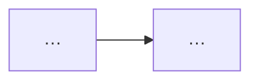

# 02 设计：<功能名>

## 概览


## 模块与文件
| 路径 | 新增/修改 | 职责 |
|---|---|---|

## 数据模型 / 接口
```ts
// 只写类型与签名
```

## 平台配置（如 package.json contributes / 路由表）

## 关键决策（ADR）
- ADR-1：选项 A / B → 选择 … → 理由 … → 代价 …

## AC 映射
| AC | 实现位置 / 机制 |
|---|---|

## 测试策略
- 单测：… / 集成：… / E2E：…
