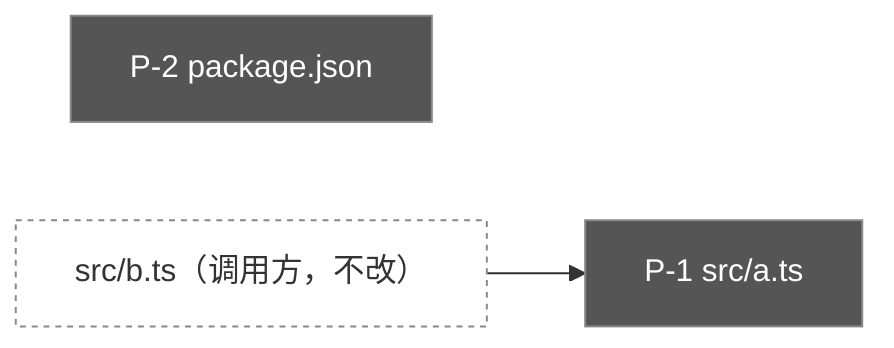

# 01b 影响定位：<功能名>

## 一览
| 点 | 覆盖 AC | 位置 | 类型 | 风险 | 决定 |
|---|---|---|---|---|---|
| P-1 | AC-1 | [src/a.ts#L10-L30](../../src/a.ts#L10-L30) | 修改 | 🟡 | ⏳ 待定 |
| P-2 | AC-2 | [package.json#L40-L50](../../package.json#L40-L50) | 新增配置 | 🟢 | ⏳ 待定 |

## 影响图


## 审批清单
- [ ] P-1 <一句话标题>（🟡）
- [ ] P-2 <一句话标题>（🟢）

> 回复：「通过 1,2」·「驳回 2：理由」·「修改 1：意见」·「全部通过」·「按清单」（你在编辑器里勾选后使用）

---

## P-1 <标题> · AC-1 · 🟡 中
- **位置**：[src/a.ts#L10-L30](../../src/a.ts#L10-L30)（`函数名`）
- **原因**：…
- **当前代码**
```ts
// src/a.ts L10-L30（逐字摘录）
```
- **拟议改动（预览）**
```diff
 上下文行
-旧
+新
```
- **影响面**：调用方 … ；测试 …
- **风险理由**：…
- **验证**：…

---

## 未触及（本次刻意不改）
- …

## 新发现点（实现阶段追加，需单独审批）
（无）
