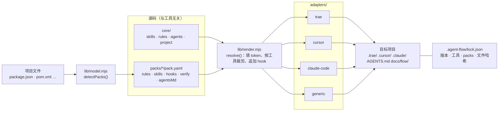
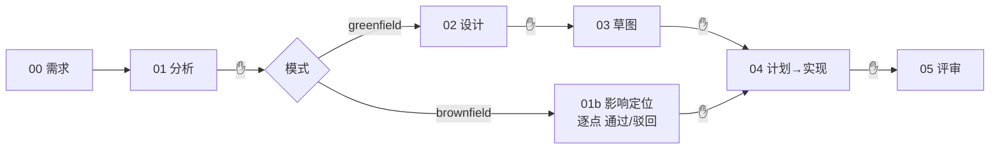

# 架构

## 一句话

`core`（流程）× `packs`（技术栈）→ `lib/render`（解析成中性模型）→ `adapters`（按工具落盘）→ 项目。

## 运行时：流程本身

## 关键概念

| 概念 | 位置 | 说明 |
|---|---|---|
| 阶段 | `core/manifest.yaml` | 阶段 → 技能、代理、交接文件、适用模式 |
| 技能 | `core/skills/<name>/SKILL.md` | 遵循 agentskills.io：`name` 与目录同名，`description` ≤ 1024 字符 |
| 中性规则 | `core/rules/*.md` | frontmatter：`name`、`description`、`globs`（字符串或列表）、`alwaysApply` |
| 中性代理 | `core/agents/*.md` | `name`、`description`、`skill`、`tools`（Trae 风格工具名）、`readonly` |
| token | 正文中的 `{{X}}` | 由 adapter 提供：`DELEGATE_HINT`、`PREVIEW_HINT`、`SKILL_READ_HINT`；pack hook 中的 `{{VERIFY_COMMANDS}}` |
| 条件块 | `<!--@only cursor-->…<!--@end-->` / `@except` | 只在某些工具中保留的文字 |
| hook | `packs/x/hooks/<stage>.md` | 追加到该阶段 SKILL.md 末尾：`## 技术栈补充（pack: x）` |

## 安装与升级的安全性

- `init` 只新建文件；已存在且不是 agent-flow 生成的文件一律跳过；已有 `AGENTS.md` → 写 `AGENTS.flow.md`；`CLAUDE.md` 已存在则保留。
- 每个写入的文件在 lock 中记录 sha256 前 16 位。`upgrade` 时：哈希一致（你没改过）→ 覆盖；不一致 → 写 `<文件>.agent-flow-new`。`--force` 才强制覆盖。
- `docs/flow/` 中的流程产物（00–05）从不由 CLI 生成或覆盖，只有 `docs/flow/README.md`。

## 兼容性

`--tool trae,cursor --packs none` 的输出与 v1.1 套件逐字节一致，只有两处例外：`flow-design` 第 6–7 步和 `flow-implement` 的两条技术栈约定已移入 pack；启用 `vscode-extension,web` 时这些原文会出现在「技术栈补充」中。由 `test/cli.test.mjs` 对照 `test/fixtures/kit-v1.1` 自动校验。
