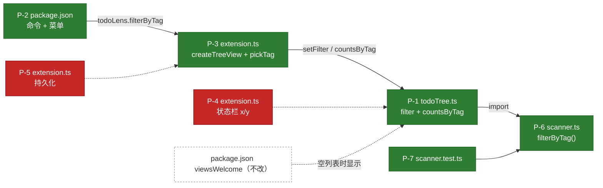

# 01b 影响定位：按标签筛选

## 一览
| 点 | 覆盖 AC | 位置（baseline 行号） | 类型 | 风险 | 决定 |
|---|---|---|---|---|---|
| P-1 | AC-2 | [src/todoTree.ts#L19-L37](../../src/todoTree.ts#L19-L37) | 修改 `getChildren` + 新增筛选状态 | 🟡 | ✅ 通过 |
| P-2 | AC-1 | [package.json#L42-L56](../../package.json#L42-L56) | 新增命令和菜单 | 🟢 | ✅ 通过 |
| P-3 | AC-1, AC-3 | [src/extension.ts#L51-L55](../../src/extension.ts#L51-L55) | 改用 `createTreeView` + 注册筛选命令 | 🟡 | ✅ 通过（已按意见修改） |
| P-4 | AC-4 | [src/extension.ts#L19-L23](../../src/extension.ts#L19-L23) | 状态栏显示 `筛选后/总数` | 🟢 | ❌ 驳回 |
| P-5 | AC-5 | [src/extension.ts#L14-L17](../../src/extension.ts#L14-L17) | 用 workspaceState 持久化筛选 | 🟢 | ❌ 驳回 |
| P-6 | AC-2 | [src/scanner.ts#L36](../../src/scanner.ts#L36)（文件末尾追加） | 新发现：抽出纯函数 `filterByTag` | 🟢 | ✅ 通过（实现阶段追加） |
| P-7 | AC-2 | [test/scanner.test.ts#L27](../../test/scanner.test.ts#L27)（文件末尾追加） | 新发现：为 `filterByTag` 补单测 | 🟢 | ✅ 通过（实现阶段追加） |

## 影响图


## 审批清单
- [x] P-1 TreeProvider 支持按标签筛选（🟡）
- [x] P-2 contributes 中新增 `todoLens.filterByTag` 命令和标题栏按钮（🟢）
- [x] P-3 改用 `createTreeView`，QuickPick 显示各标签数量，并设置 `view.description`（🟡）
- [ ] ~~P-4 状态栏显示 `筛选后/总数`~~ ❌ 驳回：状态栏保持只显示总数，避免误解
- [ ] ~~P-5 筛选状态持久化~~ ❌ 驳回：本版本不做，下个版本再说
- [x] P-6 scanner.ts 抽出 `filterByTag` 纯函数（🟢，实现阶段新发现）
- [x] P-7 补充 `filterByTag` 单测（🟢，实现阶段新发现）

> 回复：「通过 1,2」·「驳回 2：理由」·「修改 1：意见」·「全部通过」·「按清单」

## 审批记录
| 时间（UTC+8） | 你的回复 | 结果 |
|---|---|---|
| 10-19 11:20 | `修改 3：QuickPick 里显示每个标签的数量` | 重写 P-3 预览；**联动** P-1 新增 `countsByTag()` |
| 10-19 11:24 | `通过 1,2,3` | P-1、P-2、P-3 → approved |
| 10-19 11:24 | `驳回 4：状态栏保持只显示总数，避免误解` | P-4 → rejected（AC-4 不实现） |
| 10-19 11:25 | `驳回 5：先不做持久化，下个版本再说` | P-5 → rejected（AC-5 不实现）；pending 为空 → status: approved |
| 10-19 11:41 | `通过 6,7`（实现阶段 ⛔ 暂停后） | 追加的 P-6、P-7 → approved；allowed_files 新增 2 个文件 |

---

## P-1 TreeProvider 支持按标签筛选 · AC-2 · 🟡 中
- **位置**：[src/todoTree.ts#L19-L37](../../src/todoTree.ts#L19-L37)（`refresh()` 之后插入新成员；修改 `getChildren` 的根节点分支）
- **原因**：列表数据都由 `getChildren` 生成；在这里筛选，文件节点的计数（L42 的 `node.items.length`）会自动变成筛选后的数量，不需要改 `getTreeItem`。
- **当前代码**
```ts
// src/todoTree.ts L28-L37（逐字摘录；L19-L26 为 clear/refresh/total，只作插入锚点）
  getChildren(node?: Node): Node[] {
    if (!node) {
      return [...this.byFile.values()]
        .sort((a, b) => a.uri.fsPath.localeCompare(b.uri.fsPath))
        .map(f => ({ kind: 'file' as const, uri: f.uri, items: f.items }));
    }
    return node.kind === 'file'
      ? node.items.map(item => ({ kind: 'todo' as const, uri: node.uri, item }))
      : [];
  }
```
- **拟议改动（预览）**
```diff
   refresh(): void { this.emitter.fire(undefined); }
 
+  private tag: string | undefined;            // undefined = 全部
+  get filter(): string | undefined { return this.tag; }
+  setFilter(tag: string | undefined): void { this.tag = tag; }
+  countsByTag(): Map<string, number> { … }    // 联动 P-3：QuickPick 中显示数量
 …
       return [...this.byFile.values()]
-        .sort((a, b) => a.uri.fsPath.localeCompare(b.uri.fsPath))
-        .map(f => ({ kind: 'file' as const, uri: f.uri, items: f.items }));
+        .map(f => ({ kind: 'file' as const, uri: f.uri, items: f.items.filter(i => !this.tag || i.tag === this.tag) }))
+        .filter(f => f.items.length > 0)
+        .sort((a, b) => a.uri.fsPath.localeCompare(b.uri.fsPath));
```
- **影响面**：调用方只有 VS Code 的 TreeView；`total` 保持不变（状态栏仍显示总数）。
- **风险理由**：改变了已有函数的输出，但默认 `tag = undefined`，与 v0.1 的行为一致。
- **验证**：F5 → 筛选 FIXME → 只剩 FIXME 条目，文件计数正确。

## P-2 新增命令与标题栏按钮 · AC-1 · 🟢 低
- **位置**：[package.json#L42-L56](../../package.json#L42-L56)
- **原因**：AC-1 要求标题栏有筛选按钮。
- **当前代码**
```jsonc
// package.json L42-L56（逐字摘录）
    "commands": [
      {
        "command": "todoLens.refresh",
        "title": "TODO Lens: 重新扫描",
        "icon": "$(refresh)"
      }
    ],
    "menus": {
      "view/title": [
        {
          "command": "todoLens.refresh",
          "when": "view == todoLens.list",
          "group": "navigation"
        }
      ]
```
- **拟议改动（预览）**
```diff
         "icon": "$(refresh)"
+      },
+      { "command": "todoLens.filterByTag", "title": "TODO Lens: 按标签筛选", "icon": "$(filter)" }
-      }
     ],
 …
           "group": "navigation"
+        },
+        { "command": "todoLens.filterByTag", "when": "view == todoLens.list", "group": "navigation" }
-        }
       ]
```
- **影响面**：只是新增贡献点，不影响已有命令。 **验证**：标题栏出现漏斗图标。

## P-3 TreeView 与筛选命令 · AC-1, AC-3 · 🟡 中（已按「修改 3」更新）
- **位置**：[src/extension.ts#L51-L55](../../src/extension.ts#L51-L55)
- **原因**：要设置 `view.description`（AC-3），需要拿到 `TreeView` 对象，而 `registerTreeDataProvider` 只返回 Disposable，所以改用 `createTreeView`。
- **当前代码**
```ts
// src/extension.ts L51-L55（逐字摘录）
  context.subscriptions.push(
    tree,
    status,
    vscode.window.registerTreeDataProvider('todoLens.list', tree),
    vscode.commands.registerCommand('todoLens.refresh', scanAll),
```
- **拟议改动（预览）**
```diff
+  const view = vscode.window.createTreeView('todoLens.list', { treeDataProvider: tree });
+  const pickTag = async () => {
+    const counts = tree.countsByTag();                       // ← 「修改 3」新增
+    const picks = [{ label: '全部', description: `${tree.total}`, tag: undefined },
+      ...config().keywords.map(k => ({ label: k, description: `${counts.get(k) ?? 0}`, tag: k }))];
+    const sel = await vscode.window.showQuickPick(picks, { placeHolder: '按标签筛选 TODO' });
+    if (!sel) { return; }
+    tree.setFilter(sel.tag);
+    view.description = sel.tag ? `筛选：${sel.tag}` : undefined;
+    tree.refresh();
+  };
   context.subscriptions.push(
     tree,
     status,
-    vscode.window.registerTreeDataProvider('todoLens.list', tree),
+    view,
     vscode.commands.registerCommand('todoLens.refresh', scanAll),
+    vscode.commands.registerCommand('todoLens.filterByTag', pickTag),
```
- **影响面**：`withProgress({ viewId })`（L37）仍然可以使用；`view` 放入 subscriptions，会被正确释放。
- **风险理由**：替换了视图注册方式，属于激活路径上的改动。 **验证**：集成测试检查命令已注册；手动验证描述是否显示。

## P-4 状态栏显示筛选后数量 · AC-4 · 🟢 低 —— ❌ 驳回
- **位置**：[src/extension.ts#L19-L23](../../src/extension.ts#L19-L23)
- **当前代码**
```ts
// src/extension.ts L19-L23（逐字摘录）
  const updateStatus = () => {             // AC-3：状态栏显示总数
    status.text = `$(checklist) ${tree.total}`;
    status.tooltip = `TODO Lens：共 ${tree.total} 条`;
    status.show();
  };
```
- **拟议改动（预览）**
```diff
-    status.text = `$(checklist) ${tree.total}`;
+    status.text = tree.filter ? `$(filter) ${tree.visibleCount}/${tree.total}` : `$(checklist) ${tree.total}`;
```
- **驳回理由（你的原话）**：状态栏保持只显示总数，避免误解。

## P-5 筛选持久化 · AC-5 · 🟢 低 —— ❌ 驳回
- **位置**：[src/extension.ts#L14-L17](../../src/extension.ts#L14-L17)
- **当前代码**
```ts
// src/extension.ts L14-L17（逐字摘录）
export function activate(context: vscode.ExtensionContext) {
  const tree = new TodoTreeProvider();
  const status = vscode.window.createStatusBarItem(vscode.StatusBarAlignment.Left, 50);
  status.command = 'workbench.view.extension.todoLens';
```
- **拟议改动（预览）**
```diff
   const tree = new TodoTreeProvider();
+  tree.setFilter(context.workspaceState.get<string>('todoLens.filter'));
```
（并在 `pickTag` 中调用 `context.workspaceState.update('todoLens.filter', sel.tag)`）
- **驳回理由**：先不做持久化，下个版本再说。

---

## 未触及（本次刻意不改）
- `src/todoTree.ts` 中的 `getTreeItem`（L39-L56）：文件计数自动取筛选后的 items，不需要修改
- `package.json` 中的 `viewsWelcome`（L36-L41）：筛选结果为空时的文案问题，**留给评审确认**
- `src/scanner.ts` 中的 `parseTodos`：解析逻辑不变

## 新发现点（实现阶段追加，需单独审批）
### P-6 抽出纯函数 `filterByTag` · AC-2 · 🟢（11:38 追加，11:41「通过 6,7」）
- **位置**：[src/scanner.ts#L36](../../src/scanner.ts#L36) 之后追加
- **原因**：P-1 的筛选写在 `todoTree.ts` 里，而 `todoTree.ts` 依赖 vscode，无法用 node:test 单测；AC-2 需要自动化测试。
```diff
 }
+
+export function filterByTag(items: readonly TodoItem[], tag: string | undefined): TodoItem[] {
+  return tag === undefined ? [...items] : items.filter(i => i.tag === tag);
+}
```
### P-7 补充单测 · AC-2 · 🟢（同上）
- **位置**：[test/scanner.test.ts#L27](../../test/scanner.test.ts#L27) 之后追加一个 `test(...)`，并修改 L4 的 import
