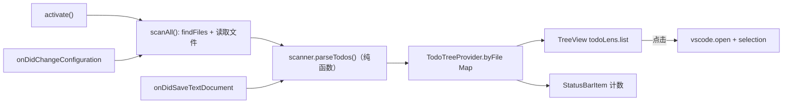

# 02 设计：TODO Lens

## 概览


## 模块与文件
| 路径 | 新增/修改 | 职责 |
|---|---|---|
| `src/scanner.ts` | 新增 | 纯函数：`buildMatcher`、`parseTodos`，不依赖 vscode，方便单测 |
| `src/todoTree.ts` | 新增 | `TreeDataProvider`：保存按文件的结果、计算总数、生成 TreeItem |
| `src/extension.ts` | 新增 | 激活入口：扫描、事件订阅、状态栏、命令注册 |
| `package.json` | 新增 | `contributes`：viewsContainers / views / viewsWelcome / commands / menus / configuration |
| `test/scanner.test.ts` | 新增 | node:test 单测（AC-5） |
| `src/test/extension.test.ts` + `.vscode-test.mjs` | 新增 | @vscode/test-cli 集成测试冒烟 |

## 数据模型 / 接口
```ts
interface TodoItem { line: number; column: number; tag: string; text: string } // 行号和列号都从 0 开始
function parseTodos(content: string, keywords: readonly string[]): TodoItem[];
class TodoTreeProvider implements vscode.TreeDataProvider<Node> {
  setFile(uri: vscode.Uri, items: TodoItem[]): void; clear(): void; refresh(): void; readonly total: number;
}
type Node = { kind: 'file'; uri; items } | { kind: 'todo'; uri; item };
```

## 平台配置
- 活动栏容器 `todoLens`（图标 `$(checklist)`），视图 `todoLens.list`，用 `viewsWelcome` 实现空状态（AC-6）
- 命令 `todoLens.refresh`（放在视图标题栏）
- 配置：`todoLens.keywords: string[] = ["TODO","FIXME"]`、`todoLens.exclude: string`、`todoLens.maxFiles: number = 2000`
- 激活事件 `onStartupFinished`，不拖慢 VS Code 启动
- Disposable：tree、statusBar、provider 注册、命令、两个事件监听，全部放入 `context.subscriptions`

## 关键决策（ADR）
- ADR-1：正则逐行匹配 vs 语言服务器 / tree-sitter 解析注释 → **选择正则**。理由：零依赖、周末就能完成。代价：字符串里的内容会误报（已在 01 中声明为范围外）。
- ADR-2：保存时增量更新单个文件 vs 防抖后全量重扫 → **增量**。理由：满足 AC-4 的 1 秒要求。代价：在 VS Code 外部修改的文件需要手动刷新。
- ADR-3：构建用 tsc vs esbuild → **tsc**。理由：没有运行时依赖，用不上打包。代价：发布时多几个文件；以后加依赖再换 esbuild。

## AC 映射
| AC | 实现位置 / 机制 |
|---|---|
| AC-1 | `extension.ts` `scanAll` + `todoTree.getChildren` 按文件分组 |
| AC-2 | `todoTree.getTreeItem` 设置 `command: vscode.open` + `selection` |
| AC-3 | `extension.ts` `updateStatus`；`status.command` 打开视图容器 |
| AC-4 | `onDidSaveTextDocument` → `tree.setFile` 只更新单个文件 |
| AC-5 | `onDidChangeConfiguration` → `scanAll`；`test/scanner.test.ts` |
| AC-6 | `viewsWelcome`；`files.length >= maxFiles` 时调用 `showWarningMessage` |

## 测试策略
- 单测：`parseTodos`（注释形式、自定义关键字、正则转义、空关键字）
- 集成：@vscode/test-cli 验证命令已注册
- 手动：AC-2、AC-3、AC-4 按 03 草图的路径各走一遍
