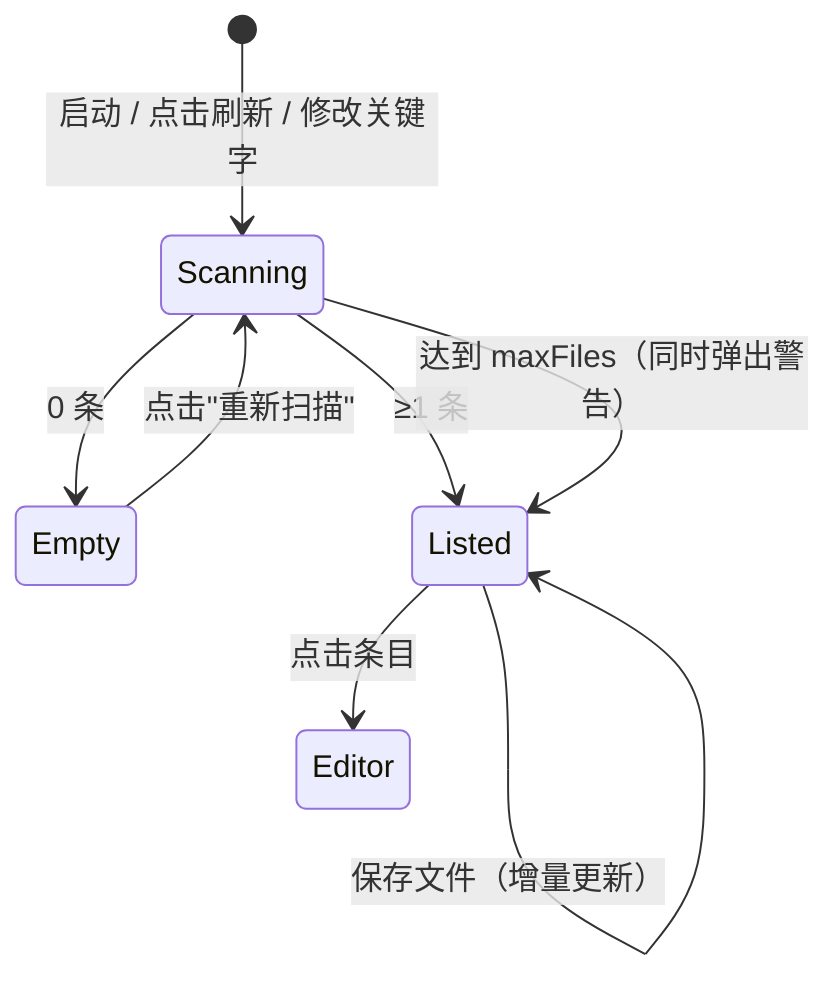

# 03 草图：TODO Lens

可交互原型：[`03-sketch.html`](./03-sketch.html)（双击打开，顶部按钮可切换 空 / 正常 / 超限 三种状态）

## 界面清单
1. 活动栏图标 + 侧边栏视图「TODO 列表」（AC-1、AC-2、AC-6）
2. 状态栏计数项（AC-3）
3. 视图标题栏的刷新按钮（AC-1）、超限警告通知（AC-6）

## 线框：正常状态（AC-1、AC-2）
```
┌ TODO LENS: TODO 列表 ───────────────── ⟳ ┐
│ ▾ 📄 src/extension.ts                  2 │
│     ○ TODO: 改成读取配置          L12    │  ← 点击 → 打开文件并定位到 L12
│     ⚠ FIXME: 处理读取失败          L30   │
│ ▾ 📄 src/utils/date.ts                 1 │
│     ○ TODO: 支持时区               L4    │
└──────────────────────────────────────────┘
状态栏： $(checklist) 3      ← 点击打开此视图（AC-3）
```

## 线框：空状态（AC-6）
```
┌ TODO LENS: TODO 列表 ───────────────── ⟳ ┐
│ 当前工作区没有找到 TODO / FIXME 注释。   │
│ [ 重新扫描 ]                             │
└──────────────────────────────────────────┘
状态栏： $(checklist) 0
```

## 线框：超限（AC-6）
```
⚠ TODO Lens：文件数达到上限 2000，结果可能不完整。     [通知，右下角]
```

## 交互路径


## 刻意没画的
- 条目右键菜单、过滤框、按关键字分组：都在范围外
- 加载态：使用视图自带的进度条（`withProgress` + `viewId`），不另外画
